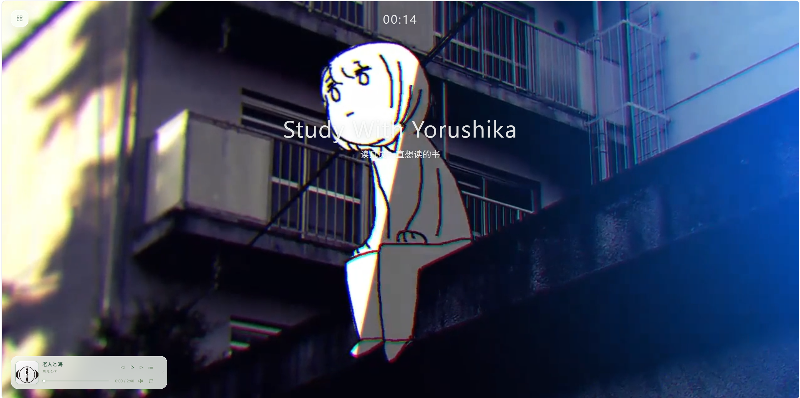

# Study With Yorushika

## 和Yorushika小人一起学习吧

### 感谢n-buna 感谢suis

### 我要听一辈子Yorushika(This is ture music)

## 简介
- 根本没有简介 看我的网站就行了
- [访问网站](https://studywithyorushika.online/)
- 目前纯前端

## 鸣谢
- 白噪音: https://github.com/rafaelmardojai

## 开发者
- 项目负责人: [Itachi-114514](https://github.com/Itachi-114514)
- bilibili:  [平和水豚](https://space.bilibili.com/3747549567520321)
- 抖音: [平和水豚](https://www.douyin.com/user/MS4wLjABAAAAWKtTNqAJ6HMZTZ05-WEMR47U_ZQ-VUKNDx2wx4mYGGmkNneG8BPA5Hvd_XQI1u4n?from_tab_name=main)
- 快手: [平和水豚](https://www.kuaishou.com/profile/3x2fwmvz37cse9w?source=NewReco)

## 喜欢的话麻烦点下小星星
- 没人觉得 i tte 很好听吗吗